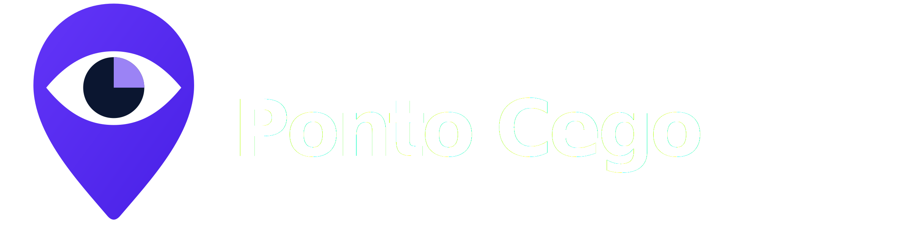
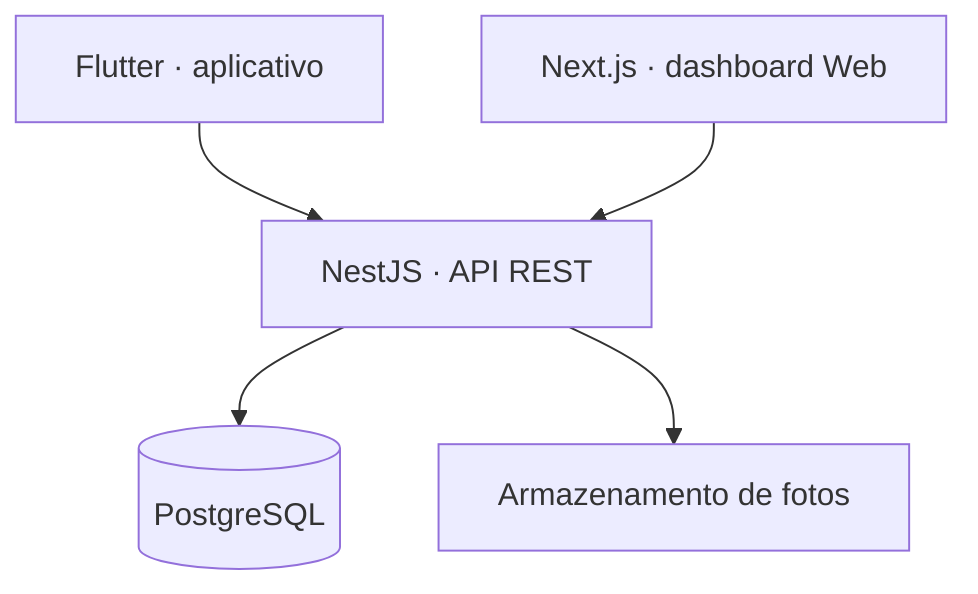
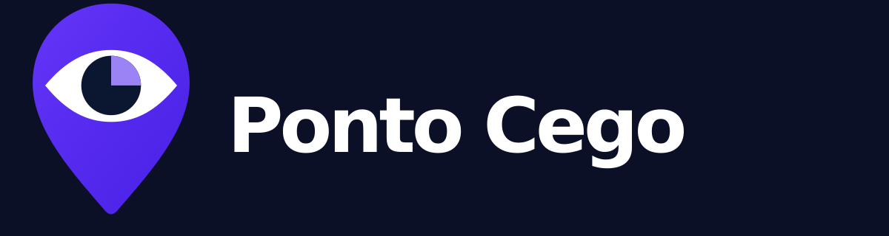
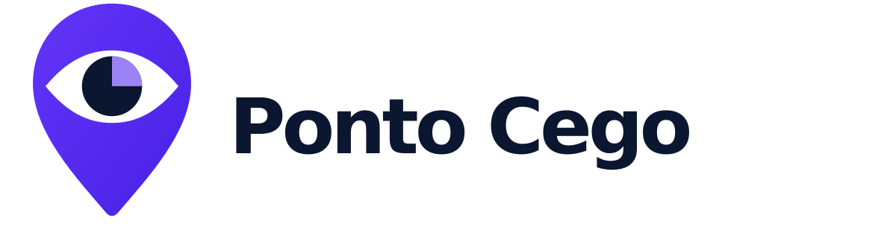

<div align="center">



### Tornando visíveis as barreiras que passam despercebidas.

**Plataforma colaborativa de identificação e gestão de barreiras de acessibilidade.**

  

</div>

---

## Por que o Ponto Cego?

Barreiras físicas e de orientação nem sempre têm um canal claro de registro, priorização e acompanhamento. O **Ponto Cego** propõe aproximar a comunidade dos responsáveis pelos espaços, transformando relatos em ações rastreáveis.

> **Projeto em fase de planejamento:** a ocorrência e as características desse problema no SENAI ainda precisam ser verificadas em pesquisa de campo. Não há aplicativo implementado nem garantia de acessibilidade de qualquer ambiente.

## Como funcionará

1. A comunidade consulta os relatos e **registra uma barreira** pelo aplicativo, informando categoria, local, descrição e foto opcional.
2. A ocorrência entra no **painel Web** e é analisada por um gestor autorizado.
3. O gestor define **prioridade, responsável e andamento**, mantendo histórico de alterações.
4. O usuário acompanha a evolução e a resolução no aplicativo.

O fluxo principal será **Aberta → Em análise → Em andamento → Resolvida**.

## Produtos planejados

| 📱 Mobile · Flutter | 🖥️ Web · Next.js |
|---|---|
| Cadastro e autenticação | Painel de indicadores |
| Consulta de locais e ocorrências | Triagem e filtros |
| Registro de barreiras e evidências | Prioridade e atribuição |
| Acompanhamento de status e histórico | Atualização de status e histórico |

### Stack proposta



A API será responsável pela autenticação, validação e autorização. O banco relacionará usuários, ocorrências e ambientes a uma **organização** desde o início.

## Escopo realista de seis semanas

| Semana | Entrega esperada |
|---|---|
| 1 | Pesquisa de campo, requisitos e wireframes |
| 2 | Arquitetura, design e primeiras interfaces |
| 3 | API, autenticação e CRUD do aplicativo |
| 4 | Dashboard Web e integração |
| 5 | Testes, acessibilidade e documentação |
| 6 | Demonstração e apresentação |

**Não entram no MVP:** mapa urbano público, rotas acessíveis, GPS indoor, reconhecimento de imagens por IA, sistema completo para múltiplas instituições e laudos técnicos.

## Evolução além do SENAI

- **Fase 1 — Institucional (piloto):** uma unidade SENAI, com comunidade e gestores.
- **Fase 2 — Multi-instituição:** escolas, universidades e empresas gerenciam seus próprios espaços e registros, com isolamento de dados.
- **Fase 3 — Rede colaborativa:** expansão para estabelecimentos e espaços urbanos, mediante moderação, validação e recursos geográficos.

O MVP atenderá uma única instituição, mas a modelagem de `organizations` e `memberships` facilitará a expansão posterior.

## Identidade visual

O logo une um **marcador de localização** e um **olho**, representando a ideia de encontrar barreiras antes invisíveis.

<div align="center">
  
  
</div>

Arquivos em [assets/branding](assets/branding). A cor principal é roxo; azul-marinho e lavanda compõem a identidade.

## Documentação e design

- [Visão e requisitos (v0.1)](docs/requisitos.md)
- [Pesquisa e validação do problema](docs/pesquisa.md)
- [Arquitetura e expansão](docs/arquitetura.md)
- [Wireframes e fluxos](docs/wireframes.md)
- [Guia de identidade visual](assets/branding/README.md)

## Acessibilidade, privacidade e transparência

A plataforma deverá atender requisitos de **teclado, contraste, rótulos de formulário e leitores de tela**. Fotos e informações de usuários precisarão de proteção adequada; os relatos não devem ser tratados como pareceres técnicos. Resultados de pesquisa ainda não foram coletados e não serão apresentados como fatos.

---

<div align="center"><strong>Projeto acadêmico de Desenvolvimento de Sistemas · SENAI</strong><br/>Documentação inicial, sujeita a validação.</div>

## Landing page

A apresentação do projeto está implementada neste repositório com **Next.js (App Router), TypeScript, Tailwind CSS, Motion e Lucide React**. Esta entrega é uma landing page: as telas do aplicativo e da gestão são demonstrações conceituais, identificadas com dados ilustrativos. O produto descrito acima permanece em planejamento, sem backend implementado nesta entrega.

### Executar localmente

Requisito: **Node.js 20.9 ou superior** e npm.

```bash
npm ci
npm run dev
```

Abra [http://localhost:3000](http://localhost:3000).

### Verificar e gerar a versão de produção

```bash
npm run check   # ESLint e TypeScript
npm run build   # exportação estática em out/
npm start       # prévia local do build em http://localhost:3000
```

Para outra porta na prévia estática, configure a variável de ambiente `PORT`. A pasta `out/` pode ser servida por uma hospedagem estática; não requer API, banco de dados ou variáveis secretas. O servidor de `npm start` é uma prévia local, não um backend do produto.

### Organização

```text
src/app/                  Página, estilos, fontes locais e metadados
src/components/           Header, hero, comparativo, fluxo e mockups reutilizáveis
src/lib/site.ts           URL e informações de SEO da landing page
scripts/prepare-landing-assets.mjs  Cópias públicas geradas a partir da marca original
scripts/serve-static.mjs   Servidor de prévia da exportação estática
assets/branding/          Identidade visual original, preservada
```

`npm run dev` e `npm run build` preparam automaticamente as cópias dos SVGs em `public/branding/`. Os assets originais e os wireframes não são modificados. A fonte variável **Plus Jakarta Sans** é hospedada localmente, com licença em `src/app/fonts/LICENSE`.

A landing inclui menu mobile com diálogo nativo, foco visível, link de salto, controles por teclado, comparativo antes/depois e etapas selecionáveis. Em desktop, o scroll também destaca as etapas do fluxo. As animações respeitam `prefers-reduced-motion`; o conteúdo permanece disponível sem JavaScript. Open Graph, ícone, sitemap e robots são gerados no build.

### Publicar no Netlify

Na sua conta [Netlify](https://app.netlify.com/start), importe o repositório `lanaro0108/PontoCego` pelo GitHub e selecione a branch `main`. O arquivo `netlify.toml` define automaticamente:

- Diretório base: raiz do repositório.
- Comando de build: `npm run build`.
- Diretório de publicação: `out`.
- Node.js: versão 22.

A publicação é estática. O build utiliza a variável `URL` fornecida pelo Netlify para o endereço canônico, Open Graph, sitemap e robots. Para usar um domínio personalizado como endereço canônico, configure `NEXT_PUBLIC_SITE_URL` com a URL completa e execute um novo deploy. Não são necessárias credenciais no código da landing page.
