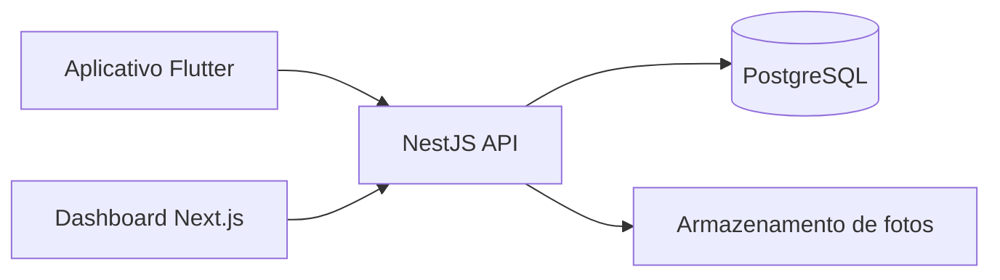

# Arquitetura e possibilidade de expansão

## Stack planejada

- **Mobile:** Flutter + Dart.
- **Web:** Next.js + TypeScript.
- **Backend:** NestJS REST + TypeScript.
- **Banco:** PostgreSQL.
- **Imagens:** object storage (a selecionar).

## Modelagem para expansão sem excesso de escopo

A aplicação começa com **uma organização ativa** e com estrutura que a identifica nos dados. A API deve verificar o vínculo `memberships` do usuário antes de permitir acesso à organização. Isso prepara a expansão para outras instituições sem implementar agora assinaturas, onboarding SaaS, faturamento ou operações multiempresa.

| Entidade | Função |
|---|---|
| `organizations` | Instituição proprietária dos locais e relatos |
| `users` | Identidade e autenticação |
| `memberships` | Papel do usuário em uma organização |
| `locations` | Hierarquia de prédios, blocos e ambientes |
| `reports` | Ocorrências, prioridade, status, responsáveis |
| `report_images` | Caminhos e metadados de imagens |
| `report_updates` | Linha do tempo de mudanças |
| `report_confirmations` | Reforço de relatos existentes, opcional |

## Endpoints candidatos
- `POST /auth/login`, `GET /me`
- `GET /locations`
- `GET /reports`, `POST /reports`, `GET /reports/:id`
- `PATCH /reports/:id/status` (gestor)
- `PATCH /reports/:id/assignment` (gestor)
- `GET /dashboard/summary` (gestor)

## Riscos a controlar
- Fotos com dados pessoais ou pessoas identificáveis.
- Usuários alterando dados de outras organizações.
- Erros no fluxo de atualização e histórico.
- Interface que contradiga o objetivo de acessibilidade.
- Relatos confundidos com avaliação técnica/certificação.

## Roadmap
1. **SENAI:** uma instituição, locais internos, registro e gestão.
2. **Instituições:** várias organizações isoladas, mais unidades, papéis e indicadores.
3. **Territórios:** mapa público, moderação, informações de acessibilidade, eventual suporte a rotas.

**Não implementar fase 2 e 3 durante as seis semanas.**
