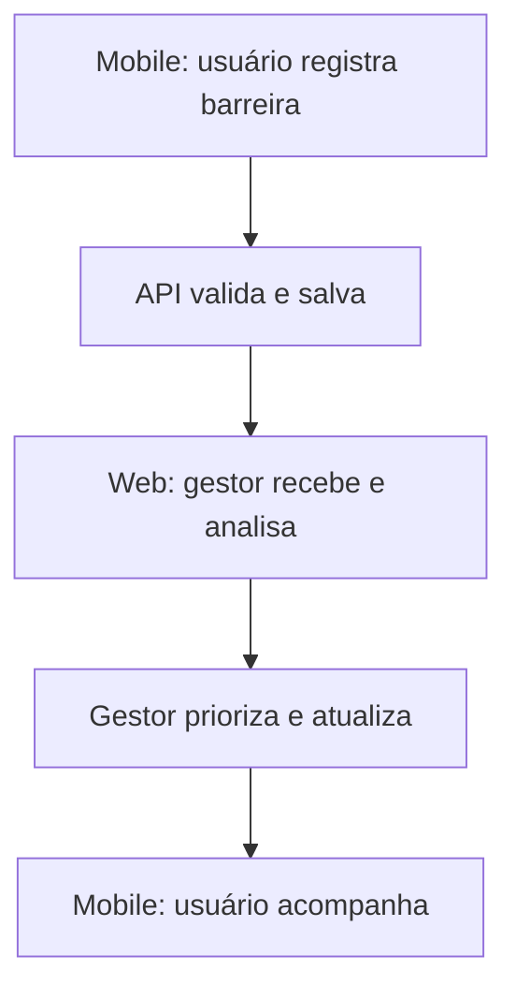

# Wireframes e navegação

São **esboços preliminares** do MVP; exemplos e valores dos protótipos são fictícios.

## Mobile

| Tela | Objetivo |
|---|---|
| Início | Atalhos para explorar ocorrências e registrar problema |
| Ocorrências | Listar, pesquisar e filtrar |
| Novo relato | Categoria, local, descrição, foto e envio |
| Detalhes | Status, informações e histórico |

## Web

| Tela | Objetivo |
|---|---|
| Dashboard | Estatísticas básicas e atividade recente |
| Gestão | Lista com filtros, prioridades e responsáveis |
| Detalhes | Histórico e alteração do status |

A navegação deve permitir uso sem mouse no Web e com leitor de tela no Mobile. GPS indoor e rotas acessíveis não fazem parte da primeira versão.

Os arquivos gráficos dos wireframes serão mantidos em `assets/wireframes/` quando publicados.
